\# Modelo de dominio (contexto: Entregas)


\## Entidades (tienen identidad propia)


| Entidad | Identidad | Atributos principales | Responsabilidad |

|---------|-----------|-----------------------|-----------------|

| `Delivery` | `DeliveryId` | `Address`, `Window`, `Status`, `CourierId?` | Raíz de agregado. Protege las reglas de asignación y de cambio de estado. |

| `Courier` | `CourierId` | `Name`, `IsOnShift` | Representa a quien ejecuta entregas. |

| `Route` | `RouteId` | `CourierId`, `Capacity`, `DeliveryIds` | Agrupa las entregas de un repartidor y controla su cupo. |


> `Delivery` es la \*\*raíz de agregado\*\*: toda modificación de una entrega pasa por sus métodos, nunca se cambian sus campos desde fuera.


\## Objetos de valor (se describen por sus atributos)


| Objeto de valor | Atributos | Regla propia |

|-----------------|-----------|--------------|

| `DeliveryId` | `Guid Value` | No puede ser `Guid.Empty`. |

| `CourierId` | `Guid Value` | No puede ser `Guid.Empty`. |

| `RouteId` | `Guid Value` | No puede ser `Guid.Empty`. |

| `DeliveryAddress` | `Street`, `City`, `Reference` | Calle y ciudad obligatorias. |

| `DeliveryWindow` | `From`, `To` | `From` debe ser anterior a `To`. |

| `RouteCapacity` | `MaxDeliveries` | Debe ser mayor que 0. |

| `DeliveryStatus` | Enumeración de estados | Solo valores definidos en el glosario. |

| `CourierAvailability` | `IsAvailable`, `HasRouteCapacity` | Resultado de una consulta; no se modifica. |


Los objetos de valor son \*\*inmutables\*\*: si cambia un atributo, se crea otro objeto.


\## Estados de `Delivery`


`ListaParaDespacho`, `Asignada`, `EnRuta`, `Entregada`, `Fallida`, `Cancelada`


\## Transiciones permitidas


| Desde | Hacia | Disparador (método del dominio) | Condición |

|-------|-------|---------------------------------|-----------|

| ListaParaDespacho | Asignada | `AssignCourier(courierId)` | No tiene repartidor activo |

| Asignada | EnRuta | `StartRoute()` | Tiene repartidor |

| EnRuta | Entregada | `MarkDelivered()` | Estaba en ruta |

| EnRuta | Fallida | `MarkFailed(reason)` | Se indica un motivo |

| ListaParaDespacho | Cancelada | `Cancel(reason)` | Se indica un motivo |

| Asignada | Cancelada | `Cancel(reason)` | Se indica un motivo |


Cualquier otra transición es \*\*inválida\*\* y el dominio la rechaza.


\## Diagrama de estados

```mermaid

stateDiagram-v2

&#x20;   \[\*] --> ListaParaDespacho

&#x20;   ListaParaDespacho --> Asignada: AssignCourier

&#x20;   ListaParaDespacho --> Cancelada: Cancel

&#x20;   Asignada --> EnRuta: StartRoute

&#x20;   Asignada --> Cancelada: Cancel

&#x20;   EnRuta --> Entregada: MarkDelivered

&#x20;   EnRuta --> Fallida: MarkFailed

&#x20;   Entregada --> \[\*]

&#x20;   Fallida --> \[\*]

&#x20;   Cancelada --> \[\*]

```





\## Mapa de entidades y relaciones


```mermaid

classDiagram

&#x20;   class Delivery {

&#x20;       +DeliveryId Id

&#x20;       +DeliveryAddress Address

&#x20;       +DeliveryWindow Window

&#x20;       +DeliveryStatus Status

&#x20;       +CourierId? CourierId

&#x20;       +AssignCourier(courierId)

&#x20;       +StartRoute()

&#x20;       +MarkDelivered()

&#x20;       +MarkFailed(reason)

&#x20;       +Cancel(reason)

&#x20;   }

&#x20;   class Courier {

&#x20;       +CourierId Id

&#x20;       +string Name

&#x20;       +bool IsOnShift

&#x20;   }

&#x20;   class Route {

&#x20;       +RouteId Id

&#x20;       +RouteCapacity Capacity

&#x20;       +AddDelivery(deliveryId)

&#x20;   }

&#x20;   Delivery "0..\*" --> "0..1" Courier : referencia por CourierId

&#x20;   Route "1" --> "0..\*" Delivery : referencia por DeliveryId

&#x20;   Route "1" --> "1" Courier : pertenece a

```


\## Decisión de diseño: referencias por identificador


`Delivery` guarda solo el `CourierId`, no el objeto `Courier` completo. Así cada agregado se mantiene pequeño y se modifica de forma independiente.

